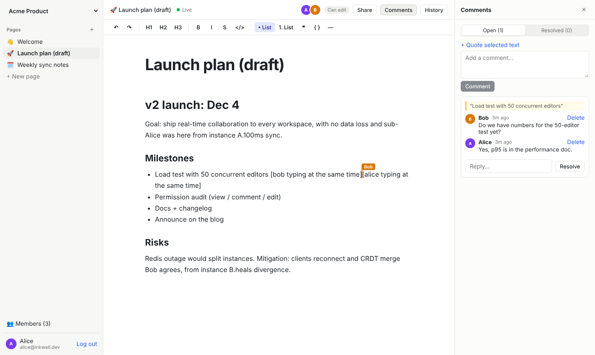

# Inkwell: real-time collaborative workspace

**Demo video (85 s, captioned, two browsers on two server instances side by side):** [docs/demo/FS-02-demo.mp4](docs/demo/FS-02-demo.mp4)

Several people edit the same document at once, see each other's cursors, and never lose changes. Notion-style pages built on **Yjs CRDTs**, a **TipTap** rich-text editor, a permission-aware **WebSocket** sync server, and **Redis** so it scales across multiple server instances.

**Stack:** React 19 · TypeScript · Vite · TipTap 3 · Yjs · y-websocket | Node 22 · Express 5 · Zod · Prisma 6 · PostgreSQL 16 · ws · Redis 7 | Vitest · Supertest | Docker · nginx · GitHub Actions



## Features

| Milestone | What's implemented |
|---|---|
| 1. CRDT conflict resolution | All document state is a Yjs CRDT. Concurrent edits at the same spot merge deterministically; offline edits merge on reconnect. See [how it works](docs/architecture.md#how-conflicts-are-resolved-milestone-1-crdts) |
| 2. Login, workspaces, pages | JWT auth, workspaces with owners/members, pages stored in PostgreSQL via Prisma (Yjs state as `bytea`), Zod validation everywhere |
| 3. Rich-text editor on Yjs | TipTap: headings, bold/italic/strike/code, lists, quotes, code blocks, dividers, collaborative undo/redo. The **title** is also a shared `Y.Text` |
| 4. Live sync over WebSocket | Custom server on `y-protocols`, wire-compatible with the stock `y-websocket` client. Debounced, merge-safe persistence; graceful flush on shutdown |
| 5. Presence | Colored, name-labeled cursors and selections, avatars of who's online, live connection status. Cleared instantly on disconnect |
| 6. Comments, history, permissions | Comment threads with quoted text, replies and resolve; auto + manual version snapshots with preview and one-click (undoable) restore; per-page **view / comment / edit** access for members and guests, **enforced on the server per message** |
| 7. Redis scaling + multi-browser tests | Instances fan out over Redis pub/sub, late joiners catch up from peers, sharing changes apply instantly on every instance. Docker Compose runs **2 API instances behind nginx**. Load-tested up to 100 simultaneous editors |

## Quick start (Docker)

```bash
docker compose up --build -d
docker compose run --rm seed       # demo data
open http://localhost:8081
```

Demo logins (password `password123`):

| User | Access on "Launch plan" |
|---|---|
| `alice@inkwell.dev` | Workspace owner (edit) |
| `bob@inkwell.dev` | Member (edit) |
| `carol@inkwell.dev` | Member, **view only** on this page |
| `dave@inkwell.dev` | **Guest** (not a member), can comment |

To see real-time collaboration, open two different browsers (or one normal window plus one incognito window), log in as Alice and Bob, and open the same page.

## Local development

Requires Node 22+, PostgreSQL 16 and Redis 7 (Redis is optional for a single instance; set `REDIS_URL=""`).

```bash
cd server
cp .env.example .env
npm install
npx prisma migrate deploy
npm run db:seed
npm run dev                          # http://localhost:4100 (REST + WebSocket)
# optional second instance to try scaling:
PORT=4101 npm run dev

cd ../web
npm install
npm run dev                          # http://localhost:5174
```

## Tests and performance

```bash
createdb collab_test
cd server && npm test                # 30 tests (2 server instances + Redis)
npm run test:coverage                # 92.8% line coverage
CLIENTS=50 EDITS=40 npm run loadtest # multi-client load test
cd ../web && npm test                # 2 tests
```

| | |
|---|---|
| Automated tests | **32**, all passing ([results](docs/test-results.md)) |
| Server coverage | **92.8%** lines |
| Sync latency, 25 concurrent editors over 2 instances | **p50 10 ms · p95 49 ms** |
| Conflicting edits at 100 concurrent editors | **4,000**, every replica identical |
| ~700 KB book-length doc cold load | **~120–160 ms** |

Details and caveats: [docs/performance.md](docs/performance.md).

## Project structure

```
server/
  prisma/schema.prisma          users, workspaces, pages (Yjs bytes), permissions, comments, snapshots
  src/collab/room.ts            one live document: sync protocol, permission checks, persistence  ← start here
  src/collab/server.ts          WebSocket endpoint, auth, room lifecycle, heartbeat
  src/collab/bus.ts             Redis pub/sub between instances
  src/collab/persistence.ts     merge-save to Postgres, auto snapshots
  src/lib/access.ts             view/comment/edit role resolution
  src/routes/                   REST: auth, workspaces, pages, sharing, comments, history
  scripts/loadtest.ts           N clients × 2 instances load test
  tests/                        collab (multi-instance), api, unit
web/
  src/collab.ts                 Y.Doc + provider hook, presence, status, title diffing
  src/components/Editor.tsx     TipTap + Collaboration + CollaborationCaret
  src/components/CommentsPanel.tsx, HistoryPanel.tsx, ShareModal.tsx
  nginx.conf                    load balancing + WebSocket upgrade
docs/                           architecture, API, performance, test results, screenshots
docker-compose.yml              db, redis, api1, api2, web (nginx)
```

## Documentation

- [Architecture, sync protocol, data model](docs/architecture.md)
- [REST + WebSocket API](docs/api.md)
- [Performance](docs/performance.md)
- [Test results](docs/test-results.md)

## Key design decisions

1. **A custom sync server instead of the reference y-websocket server**, because permissions have to be enforced on every write frame, not just at connect time; Redis fan-out and late-joiner catch-up needed hooks the reference server doesn't have.
2. **Redis as a bus, Postgres as the truth.** Redis holds no state, so it can restart freely. Saves *merge* with what's stored, so two instances can never overwrite each other.
3. **No sticky sessions.** Any instance can serve any page, so the load balancer can be dumb and instances can be added or removed freely.
4. **Restore is an edit, not an overwrite.** Rolling back replays old content through the CRDT, so it reaches everyone instantly and is undoable.
5. **404 for no access.** Page ids can't be probed.

## Known limitations / next steps

- Redis pub/sub is at-most-once; Redis Streams would close the gap during a Redis blip (CRDT sync heals it on reconnect today)
- Comments anchor by quoted text, not Yjs relative positions
- Snapshots store full state; storing diffs would save space
- A canvas (Figma-style) mode on the same Y.Doc infrastructure
- Email invitations for people without accounts
- Undo after a version restore reverts the content but not the title (the title is a separate `Y.Text` outside the editor's undo stack)
