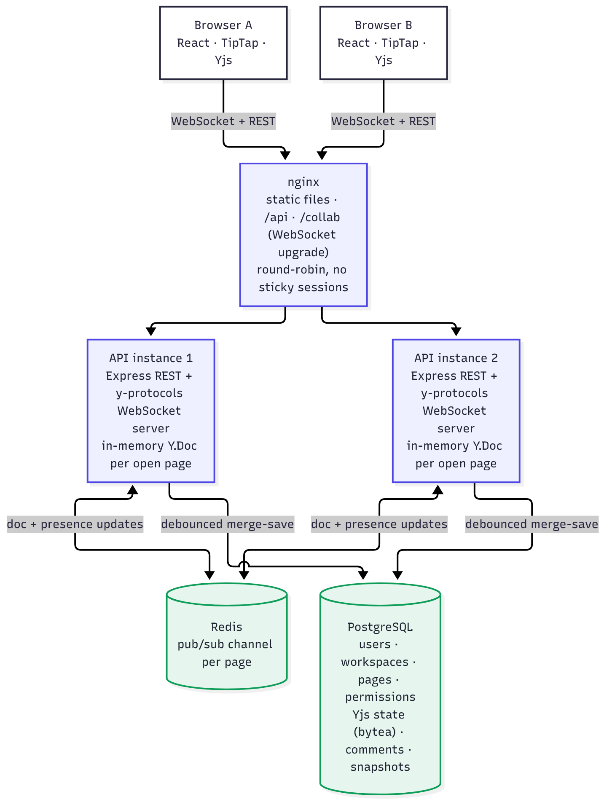
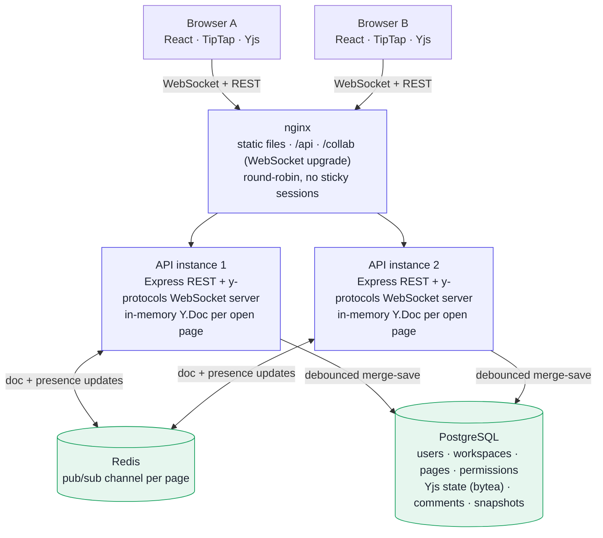
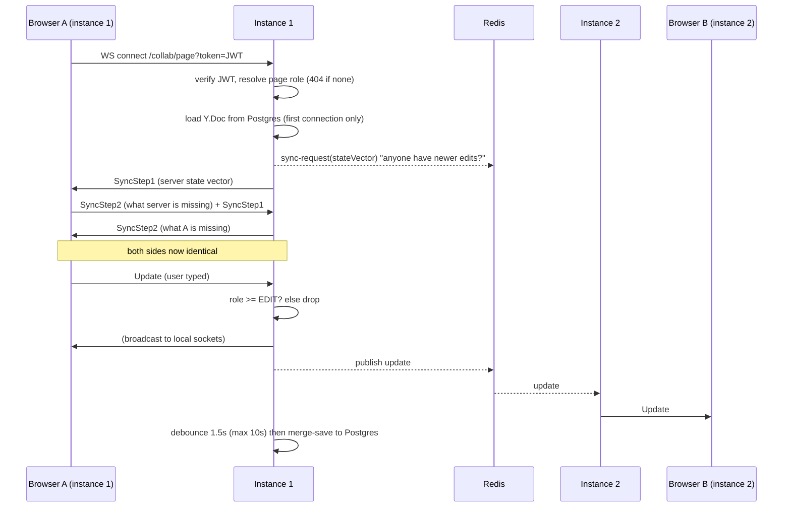
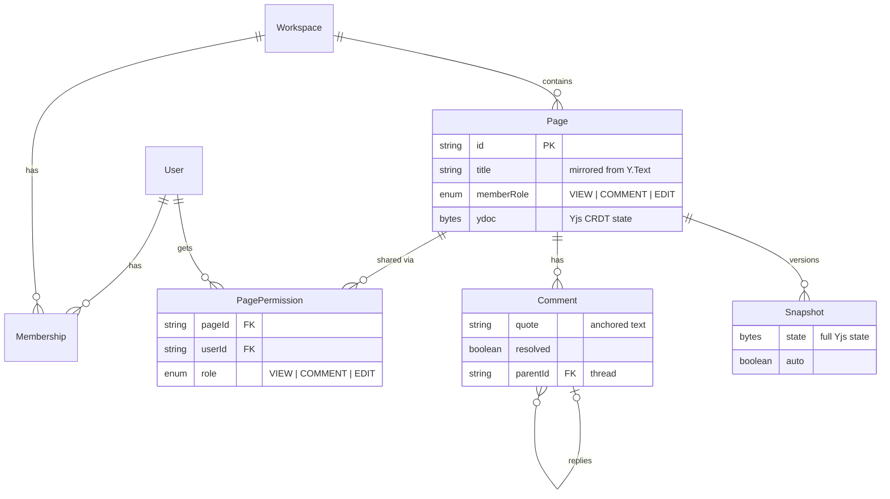

# Architecture

Mermaid source

| Component | Responsibility |
|---|---|
| **Browser** | TipTap (ProseMirror) editor bound to a `Y.Doc` through `@tiptap/extension-collaboration`. Cursors via `CollaborationCaret`. The stock `y-websocket` `WebsocketProvider` handles the socket, reconnect with backoff, and offline buffering. |
| **API instance** | One Node process serves REST (`/api`) and WebSockets (`/collab/:pageId`). Holds one in-memory `Y.Doc` + `Awareness` per open page ("room"). Enforces permissions on every incoming update. |
| **Redis** | Pub/sub only, on the channel `collab:<pageId>`. Instances publish every local document/presence update and apply what others publish. No state lives in Redis, so it can be flushed at any time. |
| **PostgreSQL** | Source of truth. The document is stored as the binary Yjs state in `Page.ydoc`. Also stores users, workspaces, permissions, comments and version snapshots. |

## How conflicts are resolved (milestone 1: CRDTs)

Every edit is a Yjs operation with a unique `(clientID, clock)` id. Inserted characters are linked to their left/right neighbours *by id*, not by index, so concurrent inserts at "the same position" are both kept and ordered deterministically (by client id). Deletions mark items as tombstones. Because merging is **commutative, associative and idempotent**:

- clients can apply updates in any order and receive duplicates, and still end in the same state;
- an offline client keeps editing locally and merges cleanly on reconnect;
- two server instances saving at the same time can merge their states (`Y.mergeUpdates`) instead of overwriting each other.

These properties are asserted directly in `server/tests/unit.test.ts` and end to end in `collab.test.ts` and the load test (4,000 random-position concurrent inserts, all replicas byte-identical).

## Sync protocol

Message framing is the standard y-websocket protocol (`0` = sync, `1` = awareness, `3` = query awareness), so the browser uses the unmodified `WebsocketProvider`. The server is written directly on `y-protocols` (rather than the reference server) because it has to:

1. **Enforce permissions per message.** Sync step 1 (a read) is allowed for everyone; step 2 and updates (writes) are applied only if the socket's role is `EDIT`. A viewer who edits the DOM or crafts WebSocket frames still cannot change the document (tested).
2. **Fan out across instances** through Redis, tagging remote updates with a `REMOTE` origin so they are not re-published (no echo loops).
3. **Catch up late joiners.** When an instance opens a page it publishes its state vector. Any instance that already holds the page replies with exactly the missing diff, so edits that haven't reached Postgres yet are never lost (tested by joining inside the persistence debounce).
4. **React to sharing changes live.** Changing a page's sharing publishes a `permissions` event. Every instance re-resolves the role of each open socket, downgrading or disconnecting (`4403`) immediately.

## Presence (milestone 5)

Presence uses the Yjs Awareness protocol: each client publishes `{ user: { name, color, userId }, cursor }`. Awareness updates travel the same path as document updates (local broadcast + Redis). When a socket closes, the server removes the awareness states that socket owned, so avatars disappear immediately; a 30-second heartbeat terminates dead sockets, and Awareness itself expires states that stop renewing. Colors are derived from the user id, so a person has the same color in every tab.

## Persistence

- **Debounced:** a dirty room saves 1.5 s after the last edit, at most every 10 s under continuous typing.
- **Merge-save:** `saveDocState` reads the stored state and writes `Y.mergeUpdates([stored, mine])`, so concurrent saves from two instances can't drop edits.
- **Graceful shutdown:** `SIGTERM` flushes every open room before exit (tested: restart an instance, content survives).
- **Title:** the page title is a `Y.Text` inside the same doc (so it's collaboratively editable). It's mirrored into `Page.title` on save for the sidebar.

## Version history (milestone 6)

- **Auto snapshots** at most every 10 minutes while a page is being edited (`AUTO_SNAPSHOT_INTERVAL_MS`). **Manual snapshots** on demand.
- A snapshot stores the full Yjs state. **Preview** decodes it in the browser (`yDocToProsemirrorJSON`) into a read-only editor.
- **Restore** saves a "Before restoring …" snapshot first, then replays the old content into the live document as a normal edit. Collaborators see it instantly, it merges like any other change, and it can be undone with Ctrl+Z.

## Permissions (milestone 6)

| | View | Comment | Edit |
|---|:-:|:-:|:-:|
| Read the page live, see cursors, read comments, browse history | ✓ | ✓ | ✓ |
| Add/reply/resolve comments | | ✓ | ✓ |
| Edit content and title, save/restore versions | | | ✓ |

Role resolution (`server/src/lib/access.ts`), in order:

1. Workspace **owner** → Edit
2. Page **creator** (still a member) → Edit
3. Explicit **page share** → that role. It can lower a member's access or grant a **guest** who isn't in the workspace.
4. Workspace **member** → the page's default (`memberRole`)
5. Otherwise → no access, which returns **404**, not 403, so page ids can't be probed

Sharing, changing the default and deleting are limited to the page creator and workspace owners.

## Data model

Full schema: [`server/prisma/schema.prisma`](../server/prisma/schema.prisma).

## Scaling (milestone 7)

- **Horizontal:** run N API instances behind any load balancer. No sticky sessions are required, because any instance can serve any page. Docker Compose runs two (`api1`, `api2`) behind nginx round-robin by default.
- **Per-page cost:** one in-memory `Y.Doc` per *open* page per instance that has a viewer of it. Rooms are unloaded 2 s after the last socket leaves (after flushing).
- **Redis traffic:** one publish per update batch per page; instances only subscribe to pages they have open.
- **Measured:** see [performance.md](performance.md). 2 instances, up to 100 simultaneous editors, 4,000 conflicting edits, all replicas converge.

### Known limits / next steps

- Redis pub/sub is fire-and-forget. If Redis blips, instances diverge until the next reconnect or join, when CRDT sync heals it. Redis Streams with replay would close that window.
- Very hot pages (hundreds of editors) would benefit from routing a page to a single "owner" instance (consistent hashing) instead of full fan-out.
- Comments are anchored by quoted text, not by Yjs relative positions, so they don't move with the text yet.
- Snapshots store full state. Storing diffs (`Y.encodeStateAsUpdate(doc, prevStateVector)`) would cut storage.
