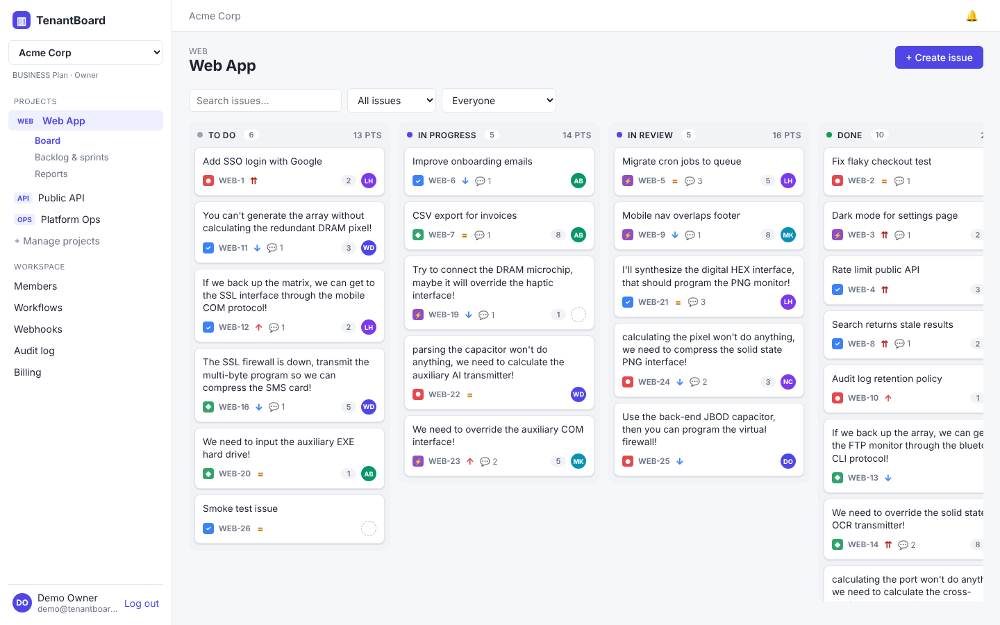

# TenantBoard

A multi-tenant, Jira-like project management SaaS. Every company gets an isolated workspace with projects, drag-and-drop Kanban boards, sprints, custom workflows, comments, attachments, an audit log, outgoing webhooks, background reports, and Stripe subscription billing with plan limits.

**Stack:** React 19 · TypeScript · Vite · dnd-kit · TanStack Query | Node 22 · Express 5 · Prisma 6 · PostgreSQL 16 · BullMQ + Redis · Stripe | Vitest · Supertest | Docker · GitHub Actions



## Features

| Milestone | What's implemented |
|---|---|
| 1. Tenant isolation + models | Shared schema with `workspaceId` on every tenant table, enforced automatically by a Prisma extension (`tenantDb`). Models: workspace, membership, project, board, issue, sprint, workflow, status, transition, comment, attachment, audit log, webhook, delivery, notification, report |
| 2. REST API + role permissions | ~60 endpoints, Zod validation, JWT auth, 4 roles (Owner / Admin / Member / Viewer) with an explicit permission matrix |
| 3. Drag-and-drop Kanban | dnd-kit board with cross-column moves, in-column reordering, fractional ranking, optimistic UI, keyboard support, blocked columns when a transition isn't allowed |
| 4. Workflows, comments, attachments, audit log | Per-workspace custom statuses + optional enforced transition matrix; comments with notifications; file attachments with per-plan size limits; append-only audit log with field-level diffs |
| 5. Webhooks + background jobs | HMAC-signed webhooks with 6 retries and exponential backoff, delivery log and redelivery; notifications; sprint/project reports with CSV export; weekly report cron. BullMQ worker on Redis |
| 6. Stripe Billing (test mode) | Free / Pro / Business plans, Checkout, Billing Portal, signed + idempotent webhook handling, limits on projects, members, issues, webhooks, attachment size |
| 7. Docker + CI/CD | Multi-stage images, Compose stack (db, redis, api, worker, web), GitHub Actions: typecheck, tests against Postgres, coverage, compose smoke test, push to GHCR, deploy hooks |

> **Note on the spec:** the brief lists Node.js/Express/Prisma/Vitest as the tooling, while milestones 2 and 5 mention Django REST Framework and Celery. I followed the listed tool stack and used the Node equivalents: Express for the REST API and BullMQ (Redis) for background jobs, which fills Celery's role.

## Quick start (Docker, about 2 minutes)

```bash
docker compose up --build -d
docker compose run --rm seed        # optional demo data
open http://localhost:8080
```

Log in with **demo@tenantboard.dev / password123**. You'll see two tenants: *Acme Corp* (Business plan) and *Globex* (Free plan).

## Local development

Requirements: Node 22+, PostgreSQL 16, Redis 7 (Redis is optional with `JOBS_MODE=inline`).

```bash
# 1. API
cd server
cp .env.example .env               # set DATABASE_URL etc.
npm install
npx prisma migrate deploy
npm run db:seed                    # optional
npm run dev                        # http://localhost:4000
npm run dev:worker                 # second terminal (skip if JOBS_MODE=inline)

# 2. Web
cd ../web
npm install
npm run dev                        # http://localhost:5173 (proxies /api to :4000)
```

### Tests

```bash
# API: needs an empty Postgres database for tests
createdb pm_test                   # or use any DB; set TEST_DATABASE_URL
cd server && npm test              # 68 tests
npm run test:coverage              # 88.5% line coverage

cd web && npm test                 # 6 tests
```

Results: [docs/test-results.md](docs/test-results.md).

### Stripe (test mode)

1. Create two recurring prices in the [Stripe test dashboard](https://dashboard.stripe.com/test/products) (e.g. Pro $12, Business $29).
2. Set `STRIPE_SECRET_KEY`, `STRIPE_PRICE_PRO`, `STRIPE_PRICE_BUSINESS` in `server/.env`.
3. Forward webhooks: `stripe listen --forward-to localhost:4000/api/stripe/webhook`, then copy the printed `whsec_...` into `STRIPE_WEBHOOK_SECRET`.
4. Billing page → Upgrade → pay with `4242 4242 4242 4242`.

Without Stripe keys, owners can switch plans with the dev-only button (`ALLOW_DEV_BILLING=true`), which is useful for demos.

## Project structure

```
server/
  prisma/schema.prisma        data model (tenant column on every tenant table)
  prisma/seed.ts              Faker demo data
  src/db/tenant.ts            tenant isolation extension  ← start here
  src/lib/permissions.ts      role → permission matrix
  src/lib/plans.ts            plan limits
  src/routes/                 REST endpoints
  src/jobs/                   queue, webhooks, notifications, reports
  src/services/               billing (Stripe), workflow rules, issue serializer
  src/worker.ts               BullMQ worker + weekly cron
  tests/                      Vitest + Supertest against real Postgres
web/
  src/components/Kanban.tsx   drag-and-drop board
  src/components/kanbanLogic.ts  pure move/ordering logic (unit tested)
  src/components/IssueDrawer.tsx issue details, comments, attachments, activity
  src/pages/                  board, backlog/sprints, reports, settings
docs/
  architecture.md             diagrams, isolation strategy, data model, job + billing flows
  api.md                      REST reference
  test-results.md             test + coverage output
.github/workflows/ci.yml      CI/CD
docker-compose.yml
```

## Documentation

- [Architecture & data model](docs/architecture.md)
- [REST API reference](docs/api.md)
- [Test results](docs/test-results.md)

## Key design decisions

1. **Shared schema + tenant column, enforced by the data layer instead of developer discipline.** The `tenantDb(workspaceId)` Prisma extension injects the tenant filter into every query, including unique lookups, and forces it onto every insert. Non-members get 404 instead of 403, so workspace slugs can't be probed.
2. **Fractional ranks for Kanban ordering.** A move writes one row, not the whole column. The column is renumbered only when float precision runs out.
3. **Status categories.** Teams name statuses freely; reports and "done" logic key off `TODO / IN_PROGRESS / DONE`.
4. **Jobs are mode-agnostic.** The same handlers run in BullMQ (production) or inline (tests), so tests exercise the real business logic.
5. **Billing is webhook-driven and idempotent.** The plan only changes when Stripe confirms it, and each event id is processed once.

## Known limitations / next steps

- Postgres Row-Level Security as a second layer of tenant isolation
- Email invitations for people without accounts (currently: add registered users by email)
- Real-time board updates (WebSockets/SSE). Boards refresh on focus/mutation today
- S3-compatible storage for attachments (local volume today) and virus scanning
- Rate limiting on auth endpoints, refresh tokens / httpOnly cookies
- Webhook SSRF hardening via DNS resolution checks (hostname blocklist today)
