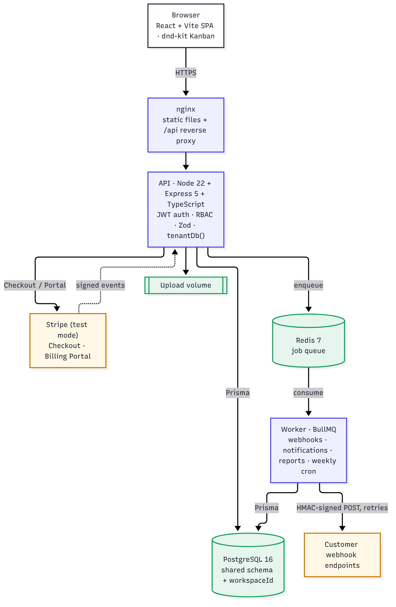
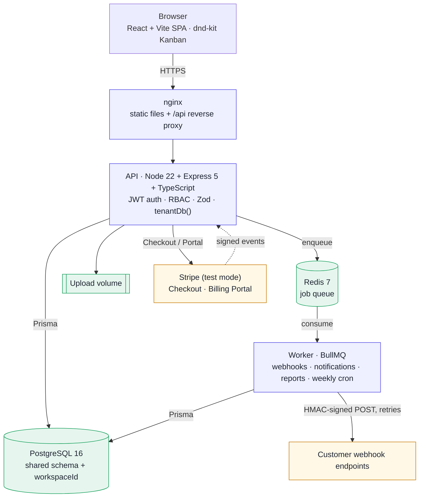
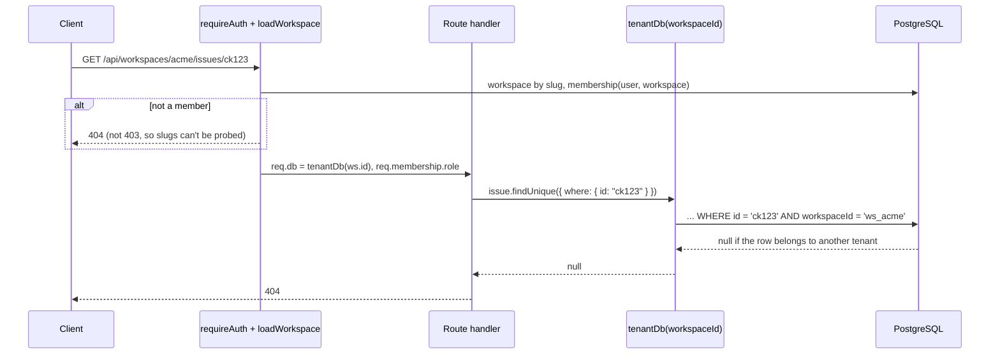
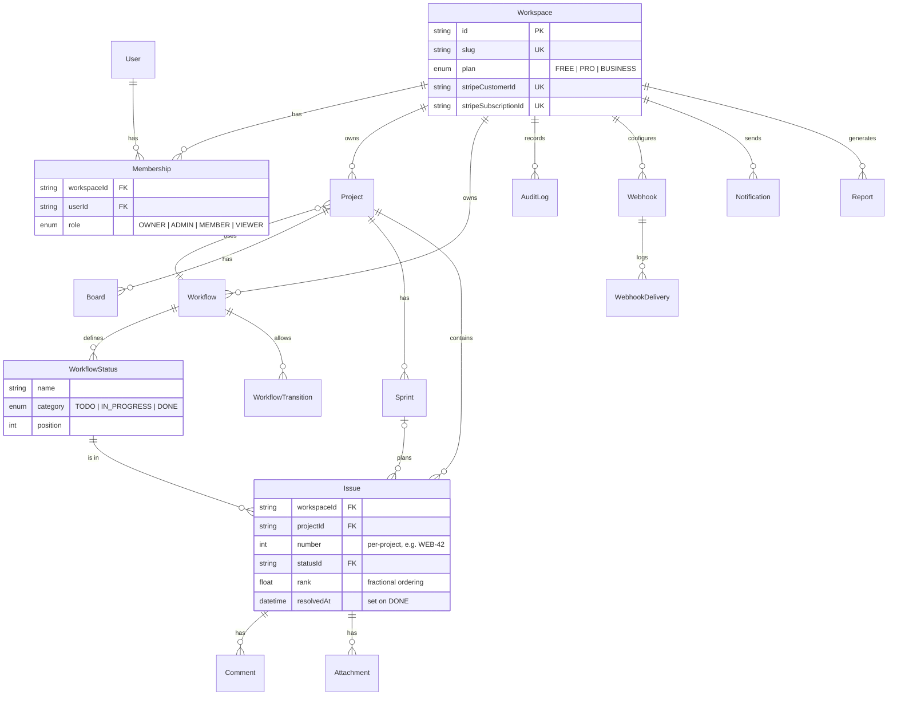
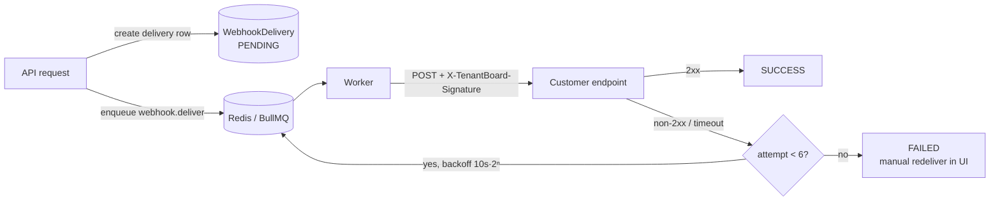
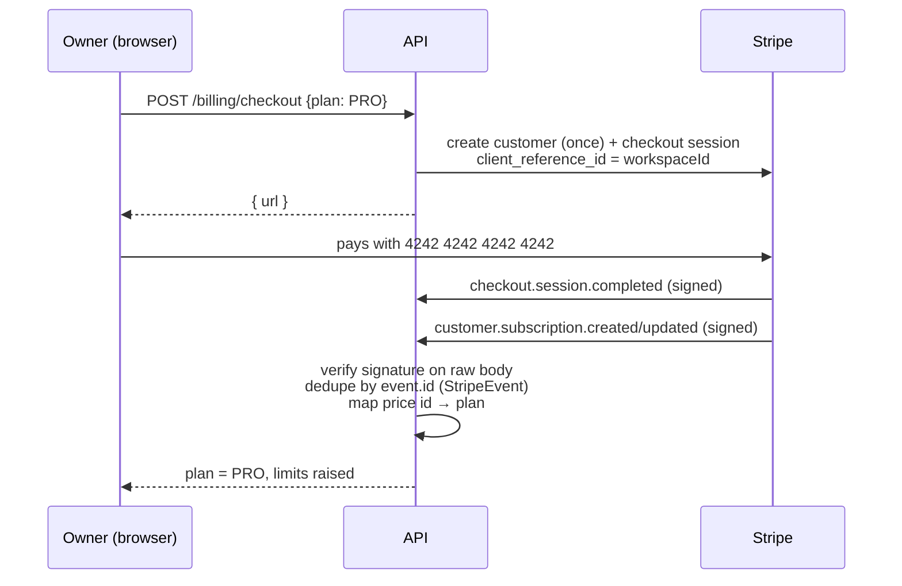

# Architecture

## System overview

Mermaid source

| Component | Responsibility |
|---|---|
| **web** | SPA. Talks only to `/api`. Mirrors the permission matrix for UI affordances; the server is the source of truth. |
| **api** | Stateless REST API. Auth, tenant resolution, RBAC, validation, writes audit entries, enqueues jobs. |
| **worker** | Webhook delivery (HMAC-signed, 6 attempts with exponential backoff), notifications, sprint/project reports, weekly report cron. |
| **PostgreSQL** | Single database, single schema. Every tenant row carries `workspaceId`. |
| **Redis** | BullMQ queue only. No application state, so it can be wiped safely. |

## Tenant isolation

**Choice:** shared database, shared schema, `workspaceId` column on every tenant-owned table.

| Option | Isolation | Ops cost | Why not / why |
|---|---|---|---|
| Database per tenant | Strongest | High: N migrations, N connection pools | Overkill for a Jira-like SaaS with many small tenants |
| Schema per tenant | Strong | Medium: migrations fan out per schema | Prisma support is awkward; connection pool per schema |
| **Shared schema + tenant column** | Enforced in app (+ optional RLS) | Low | Simplest to operate and migrate. Risk is a forgotten `WHERE`, which the design below removes |

### How a forgotten `WHERE workspaceId = ?` is prevented

`src/db/tenant.ts` is a Prisma client extension applied to **every operation on every tenant model**:

- **Reads, updates, deletes, counts, aggregates**: `workspaceId` is merged into `where`. This includes unique lookups (`findUnique`, `update`, `delete` by id), so fetching another tenant's row by a guessed id returns `null` / `P2025`.
- **Creates**: `workspaceId` is forced onto the payload and overrides any value a caller passes.
- **Updates**: `workspaceId` is stripped from the payload, so a row can never be moved between tenants.
- **Foreign keys from user input** (`statusId`, `sprintId`, `assigneeId`, `projectId`, `beforeId`/`afterId`) are always re-checked through the scoped client before use.

Route handlers never import the raw client for tenant data. The raw client is used only for global tables (`User`, `Workspace`, `StripeEvent`) and system jobs that first resolve the tenant from a row they own.

Tested in `tests/tenancy.test.ts` (API level and data-layer level) and `tests/unit.test.ts` (`scopeArgs`).

**Next step (defense in depth):** Postgres Row-Level Security with `SET app.workspace_id` per transaction, so even raw SQL is confined.

## Data model

Full schema: [`server/prisma/schema.prisma`](../server/prisma/schema.prisma).

### Design notes

- **Issue keys** (`WEB-42`): per-project counter `Project.issueSeq`, incremented atomically inside the create transaction. `@@unique([projectId, number])` guarantees no duplicates under concurrency.
- **Board ordering**: fractional `rank` (float). Dropping a card between two others sets `rank = (above + below) / 2`. One row is written per move. When the gap drops below `1e-6`, the column is renumbered (tested with 60 consecutive midpoint inserts).
- **Workflow categories**: custom status names map to one of three categories. Reports, "Done" detection and `resolvedAt` use the category, so teams can rename statuses freely.
- **Audit log**: append-only, written inside the request for every mutation, with field-level `{from, to}` diffs for issue edits.

## Roles and permissions

| Permission | Owner | Admin | Member | Viewer |
|---|:-:|:-:|:-:|:-:|
| Read workspace, issues, boards | ✓ | ✓ | ✓ | ✓ |
| Create/edit/move issues, comment, attach | ✓ | ✓ | ✓ | |
| Plan sprints, generate reports | ✓ | ✓ | ✓ | |
| Delete issues, moderate comments | ✓ | ✓ | | |
| Manage members, projects, workflows, webhooks | ✓ | ✓ | | |
| Read audit log | ✓ | ✓ | | |
| Billing, delete workspace | ✓ | | | |

Extra rules: admins cannot change or remove owners or grant `OWNER`; the last owner cannot leave or be demoted; anyone can leave a workspace. Source: `src/lib/permissions.ts`, tested in `tests/rbac.test.ts`.

## Background jobs

| Job | Trigger | Retries |
|---|---|---|
| `webhook.deliver` | issue/comment/sprint/member events | 6, exponential from 10 s |
| `notification.send` | assignment, comment, payment failure | 3 |
| `report.generate` | sprint completion, "Generate report" button | 2 |
| `report.weekly` | cron, Mondays 08:00 UTC (`upsertJobScheduler`) | 1 |

`JOBS_MODE=inline` runs the same handlers in-process (used by tests and Redis-less local dev), so business logic is identical in both modes.

**Webhook signature:** `X-TenantBoard-Signature: t=<unix>,v1=<hex>` where `v1 = HMAC_SHA256(secret, "<t>.<raw body>")`. Consumers should reject timestamps older than 5 minutes. A reference verifier is `verifySignature()` in `src/jobs/webhooks.ts`.

## Billing

- Limits live in one table (`src/lib/plans.ts`) and are enforced at creation time (`402 PLAN_LIMIT` with `{kind, limit, current}`).
- Downgrades keep existing data but block new creation above the limit.
- `invoice.payment_failed` notifies owners. `customer.subscription.deleted` drops the workspace to FREE.
- Webhook handling is idempotent: each Stripe `event.id` is stored and processed once.
