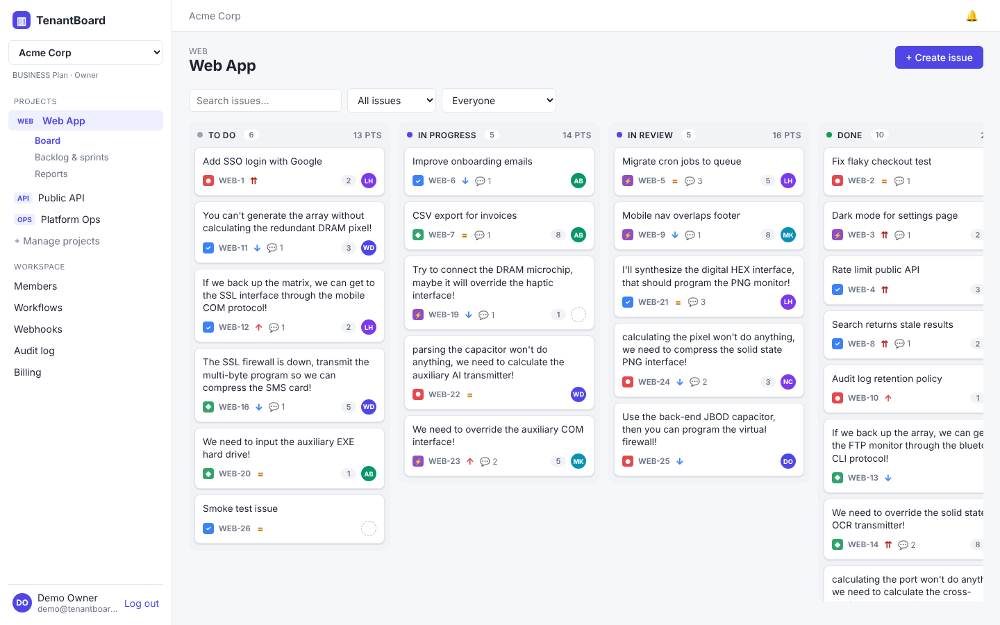
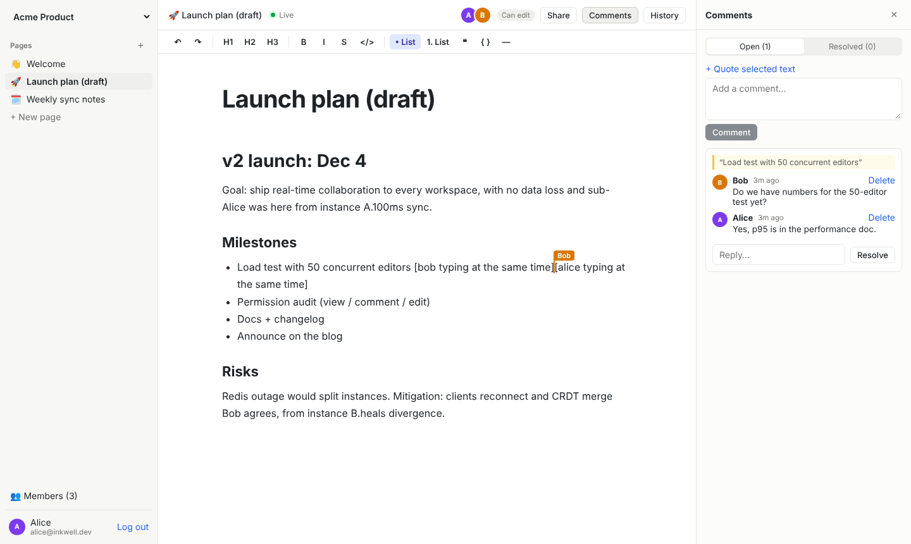

# Internship Projects

Both allotted projects, each in its own self-contained folder with source code, tests, screenshots, Docker setup, CI and documentation.

| Folder | Project | Stack | Tests |
|---|---|---|---|
| [`FS-04/`](FS-04/) | **TenantBoard**: multi-tenant SaaS project management (Jira-like): isolated workspaces, drag-and-drop Kanban, sprints, custom workflows, audit log, webhooks, Stripe billing | React, TypeScript, Node.js, Express, PostgreSQL, Prisma, BullMQ/Redis, Vitest, Docker | 74 · 88.5% coverage |
| [`FS-02/`](FS-02/) | **Inkwell**: real-time collaborative workspace (Notion-style): Yjs CRDT editing, live cursors and presence, comments, version history, view/comment/edit permissions, Redis scaling across instances | React, TypeScript, TipTap, Yjs, Node.js, Express, WebSocket, PostgreSQL, Prisma, Zod, Redis, Docker | 32 · 92.8% coverage |

---

## FS-04 · TenantBoard

- **Run:** `cd FS-04 && docker compose up --build -d && docker compose run --rm seed`, then open http://localhost:8080 (login `demo@tenantboard.dev` / `password123`)
- **Highlights:** shared-schema tenant isolation enforced automatically in the data layer, 4-role RBAC, fractional-rank drag-and-drop, HMAC-signed webhooks with retries, idempotent Stripe webhooks with plan limits
- **Docs:** [README](FS-04/README.md) · [Architecture](FS-04/docs/architecture.md) · [API](FS-04/docs/api.md) · [Test results](FS-04/docs/test-results.md) · [Screenshots](FS-04/docs/screenshots/)
- **CI:** [`.github/workflows/fs-04.yml`](.github/workflows/fs-04.yml)

## FS-02 · Inkwell

- **Run:** `cd FS-02 && docker compose up --build -d && docker compose run --rm seed`, then open http://localhost:8081 (logins `alice@` / `bob@` / `carol@` / `dave@inkwell.dev`, password `password123`). Open two browsers as Alice and Bob on the same page.
- **Highlights:** custom y-protocols WebSocket server that enforces permissions on every write frame, Redis fan-out with late-joiner catch-up, merge-safe persistence, two API instances behind nginx with no sticky sessions, load-tested to 100 concurrent editors
- **Docs:** [README](FS-02/README.md) · [Architecture](FS-02/docs/architecture.md) · [API](FS-02/docs/api.md) · [Performance](FS-02/docs/performance.md) · [Test results](FS-02/docs/test-results.md) · [Screenshots](FS-02/docs/screenshots/)
- **CI:** [`.github/workflows/fs-02.yml`](.github/workflows/fs-02.yml)

The two projects use different ports (8080 and 8081), so both can run at the same time.
